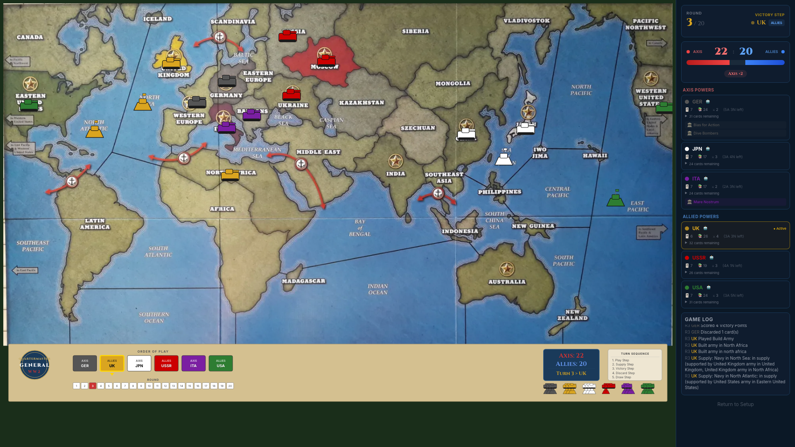
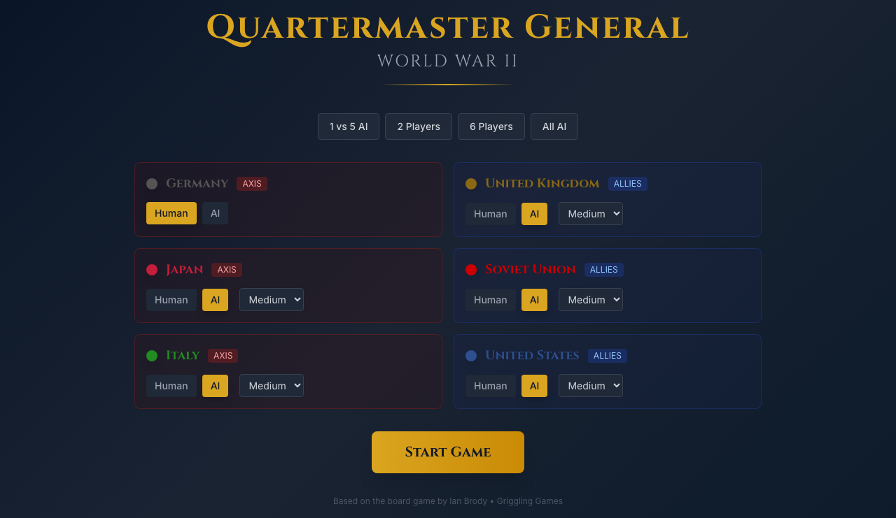

# Quartermaster General WW2 – Web Edition

A browser-based digital implementation of **Quartermaster General WW2: 2nd Edition**, built with React, TypeScript, and Vite.

> Based on the board game by Ian Brody. Learn more on [BoardGameGeek](https://boardgamegeek.com/boardgame/331979/quartermaster-general-ww2-2nd-edition).

## [Play Now](https://linksomaniac.github.io/QuarterMasterGeneralWW2/)





---

## Features

- Play as all 6 major powers: Germany, Japan, Italy (Axis) vs USA, UK, USSR (Allies)
- Card-driven gameplay with unique decks per nation
- Supply chain mechanics using BFS pathfinding
- AI opponents with easy / medium / hard difficulty
- Interactive SVG map with pan & zoom
- Fully playable in the browser — no server required

---

## Play Online

The game is hosted on GitHub Pages and requires no installation:

**[https://linksomaniac.github.io/QuarterMasterGeneralWW2/](https://linksomaniac.github.io/QuarterMasterGeneralWW2/)**

---

## Local Development

### Prerequisites

- [Node.js](https://nodejs.org/) v18 or later
- npm (included with Node.js)

### Installation

```bash
# 1. Clone the repository
git clone https://github.com/Linksomaniac/QuarterMasterGeneralWW2.git
cd QuarterMasterGeneralWW2

# 2. Install dependencies
npm install

# 3. Start the development server
npm run dev
```

Then open [http://localhost:5173/QuarterMasterGeneralWW2/](http://localhost:5173/QuarterMasterGeneralWW2/) in your browser.

### Build for Production

```bash
npm run build
```

The compiled output will be in the `dist/` folder and can be served by any static file host.

---

## Tech Stack

| Tool | Purpose |
|------|---------|
| React 18 | UI components |
| TypeScript | Type safety |
| Vite | Build tool & dev server |
| Zustand | Game state management |
| Tailwind CSS | Styling |

---

## About the Board Game

**Quartermaster General WW2: 2nd Edition** is a fast-paced, card-driven wargame for 2-6 players set in World War II. Each power has a unique deck of cards to build armies and navies, attack enemies, and maintain supply lines. Supply is everything — cut your enemy's supply and their forces surrender.

[View on BoardGameGeek](https://boardgamegeek.com/boardgame/331979/quartermaster-general-ww2-2nd-edition)

---

## Training the Hard AI

Hard AI card choice (which card to play, and which 3 of the opening 10 to discard) is a heuristic score plus a learned correction (`src/game/aiPolicy.ts`, weights in `src/game/aiWeights.json`). The weights come from self-play REINFORCE training:

```bash
node training/train.mjs --iters 250 --games 100 --workers 8   # train; checkpoints in training/out/
node training/train.mjs --eval-only --init src/game/aiWeights.json --eval-games 4000
```

Evaluation plays the learned policy against the plain heuristic AI with sides alternated.

Other training tools: `training/init-net.mjs` adds a hidden-layer network to a weights file (the policy supports one network per decision kind on top of the linear model), and `training/sides.mjs` reports the Axis vs Allies win split when all six powers use a given weights file.

### Resuming league training

Checkpoints live in `training/out6/` (git-ignored; v4 = iteration 180). To continue from iteration 180:

```bash
node training/train.mjs --iters 500 --games 150 --lr 0.03 --net-lr-mult 0.5 \
  --eval-every 30 --eval-games 1000 \
  --init training/out6/weights-180.json --baseline training/out6/weights-180.json \
  --ref training/ref/weights-v3.json --out training/out7
node training/pair-eval.mjs <pair-or-weights.json> 2000   # evaluate; shipped file must be pruned (|w|<0.02) to stay small
```
